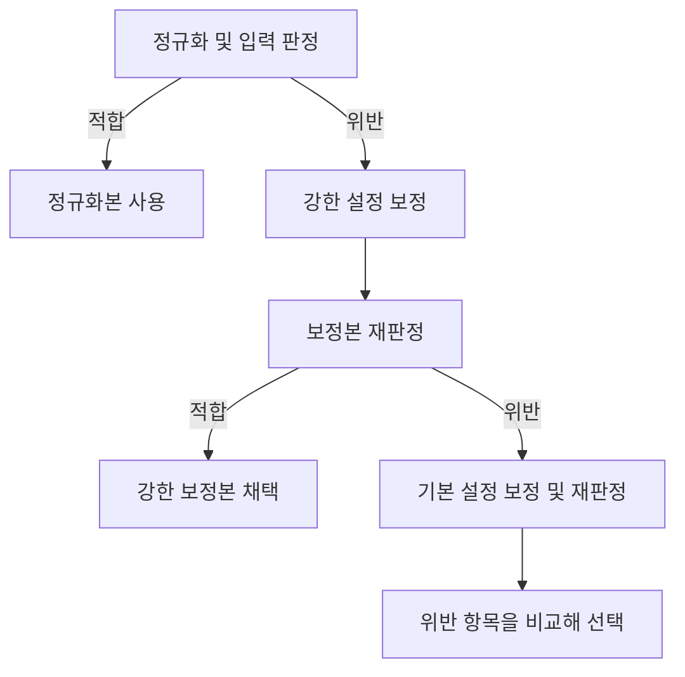

# SoftReel 숏폼 점멸 검출과 국소 보정

**기술 검증 보고서** · Kyungdon Moon · 2026년 11월

프로젝트 출처 · SKT FLY AI Challenger 9기 Team L-EOD

SoftReel은 업로드한 숏폼 영상에서 휘도 점멸, 적색 점멸 등 규칙을 위반한 구간을 찾아 보정한다. 강한 설정으로 보정한 뒤에도 위반이 남으면 기본 설정으로 한 번 더 처리하고 두 출력의 위반 항목을 비교한다. 실사 개발 로그 209편을 다시 집계한 결과, 원본에 위반이 있던 41편 중 기본 설정은 14편, 강한 설정은 19편, 재판정 후 선택은 21편을 자체 검출기에서 적합으로 바꿨다. 선택 후 20편에는 위반이 남았다.

## 1. 검출과 보정

`pse_bt1702.py`는 영상의 기본 분석 폭을 320픽셀로 맞추고 sRGB 신호를 선형광으로 변환한다. SDR 기준 백색을 200 cd/m²로 두고, 연속 프레임 사이의 휘도 변화와 변화 면적, 시간창 안의 전환 횟수를 계산한다. 적색 점멸에는 선형광에서 계산한 적색 비율과 CIE 1976 u′v′ 색도 거리를 함께 사용한다. 판정 규칙은 ITU-R BT.1702-3과 WCAG의 점멸 항목을 참조한다. [검출기](https://github.com/SKT-FLY-AI-9-6/gumchulgi/blob/bbfb1a37140e9aa393719fe5e623165e048aa4ab/psepipe_v3_seam/pse_bt1702.py) · [ITU-R 권고문](https://www.itu.int/rec/R-REC-BT.1702-3-202311-I/en) · [WCAG 점멸 기준](https://www.w3.org/WAI/WCAG22/Understanding/three-flashes-or-below-threshold.html)

`pselive3.py`는 점멸 후보 영역을 마스크로 만들고, 마스크의 가중치에 따라 현재 입력과 직전 출력 사이의 화소별 휘도와 색 변화량을 줄인다. 이 단계에서 마스크 가중치가 0인 화소의 출력은 현재 입력과 같다. CPU 구현의 강한 설정은 개입을 일찍 시작하고 휘도 변화 상한을 낮추며, 밝기 세부 복원 폭과 마스크 유지 시간을 늘린다. [CPU 필터](https://github.com/SKT-FLY-AI-9-6/gumchulgi/blob/bbfb1a37140e9aa393719fe5e623165e048aa4ab/psepipe_v3_seam/pselive3.py)

## 2. 업로드 워커의 재판정 흐름

워커는 업로드를 정규화한 뒤 입력을 판정한다. 적합이면 정규화본을 사용한다. 위반이면 강한 설정으로 보정하고 출력에 같은 검출기를 적용한다. 위반이 남을 때 기본 설정을 추가로 적용한다. 강한 보정본의 위반 항목 집합이 기본 보정본의 위반 항목 집합에 포함되면 강한 결과를 채택하고, 그 외에는 기본 결과를 채택한다. [업로드 워커](https://github.com/SKT-FLY-AI-9-6/gumchulgi/blob/bbfb1a37140e9aa393719fe5e623165e048aa4ab/server/worker/pipeline.py)

그림 1. SoftReel의 업로드 워커에서 보정본을 선택하는 과정.

## 3. 한 가지 설정으로 통일하기 어려웠던 이유

팀은 방향성 검사와 밝기 세부 복원 폭 σ=32를 함께 적용한 후보를 기본값으로 검토했다. 개발 회귀 기록에서 실사 6편의 판정이 기존 기본 설정보다 나빠졌다. 변경 요소를 나눠 실행하자 휘도 점멸이 다시 나타난 3편 모두 세부 복원 폭과 관련됐고, 그중 1편에서는 두 변경을 함께 적용했을 때 위반이 나타났다. 공개 CPU 구현은 기본 설정의 σ=2와 강한 설정의 σ=32를 모두 사용한다. [회귀 기록](https://github.com/SKT-FLY-AI-9-6/gumchulgi/blob/bbfb1a37140e9aa393719fe5e623165e048aa4ab/psepipe_v3_seam/validation/REGRESS_0820.md) · [CPU 필터](https://github.com/SKT-FLY-AI-9-6/gumchulgi/blob/bbfb1a37140e9aa393719fe5e623165e048aa4ab/psepipe_v3_seam/pselive3.py)

별도 실사 3편의 비교에서는 자체 필터와 팀의 BlazeBVD 재구현을 같은 검출기로 평가했다. 두 경로 모두 적합했던 한 영상의 인코딩 대조군 대비 경계 왜곡 점수는 자체 필터 2.542, BlazeBVD 전체 경로 29.849였다. 다른 영상에서는 BlazeBVD가 자체 필터에 남은 화면전환 위반을 해소했다. 이 비교에서는 판정 변화와 경계 왜곡을 영상별로 함께 확인했다. [비교 로그](https://github.com/SKT-FLY-AI-9-6/gumchulgi/blob/bbfb1a37140e9aa393719fe5e623165e048aa4ab/psepipe_v3_seam/validation/ad_blazebvd_full.csv)

## 4. 실사 로그 209편 재집계

오프라인 로그에서 원본에 위반이 있던 41편을 골라 같은 입력에 대한 설정별 판정을 대조했다. 적합은 자체 검출기에 기록된 결과다. [비교 CSV](https://github.com/SKT-FLY-AI-9-6/gumchulgi/blob/bbfb1a37140e9aa393719fe5e623165e048aa4ab/psepipe_v3_seam/validation/fallback_209.csv)

| 처리 방식 | 적합 전환 | 위반 잔존 |
| --- | ---: | ---: |
| 기본 설정 | 14/41 | 27/41 |
| 강한 설정 | 19/41 | 22/41 |
| 재판정 후 선택 | 21/41 | 20/41 |

두 설정 모두 적합이었던 영상은 12편, 강한 설정에서만 적합이었던 영상은 7편, 기본 설정에서만 적합이었던 영상은 2편이었다. 원본에 휘도 점멸 위반이 있던 20편은 선택 후 해당 항목을 통과했다. 전체 항목을 기준으로는 20편에 위반이 남았다. 잔존 항목은 패턴 11편, 화면전환 10편, 5초 지속 7편이며 한 영상에 여러 항목이 기록될 수 있다. 원본에 휘도 점멸 위반만 있던 1편에는 보정 후 패턴 위반이 새로 기록됐다.

강한 설정에서 위반이 남은 22편은 공개 워커의 기본 설정 재처리 조건에 해당한다. 두 결과를 비교했을 때 기본 설정 보정본을 최종 선택한 영상은 5편이었다. 두 수치는 저장된 판정으로 재구성한 값이다.

## 5. 비교 검증과 해석 범위

개발에 사용한 합성 영상 24편에서 Electronic Arts IRIS와 판정을 대조했다. 적색 채도 비율을 선형광에서 계산하도록 수정하기 전에는 18편, 수정 후에는 20편의 판정이 일치했다. 실사 19편에서는 SoftReel의 두 검출기가 17편에서 같은 판정을 냈다. 이 19편의 영상 식별자는 모두 209편 로그에도 포함된다. [IRIS 비교 기록](https://github.com/SKT-FLY-AI-9-6/gumchulgi/blob/bbfb1a37140e9aa393719fe5e623165e048aa4ab/IRIS_%EA%B5%90%EC%B0%A8%EA%B2%80%EC%A6%9D_v0.1.md) · [실사 비교 기록](https://github.com/SKT-FLY-AI-9-6/gumchulgi/blob/bbfb1a37140e9aa393719fe5e623165e048aa4ab/psepipe_v3_seam/validation/README.md)

개발에 사용한 영상이 평가에 포함됐고, 보정본 선택과 결과 집계에 같은 자체 검출기를 사용했다. 결과는 해당 개발 집합에서 관찰한 판정 변화다. 독립 판정과 실제 시청자의 반응은 별도 평가가 필요하다. 좁은 점멸 영역은 축소 과정에서 면적 문턱 아래로 줄어들 수 있다. GPU 이식판에는 CPU판의 자기감시 보정이 구현되지 않은 상태로 표시돼 있다. [검증 기록](https://github.com/SKT-FLY-AI-9-6/gumchulgi/blob/bbfb1a37140e9aa393719fe5e623165e048aa4ab/psepipe_v3_seam/validation/README.md) · [GPU 이식판](https://github.com/SKT-FLY-AI-9-6/gumchulgi/blob/bbfb1a37140e9aa393719fe5e623165e048aa4ab/psepipe_v3_seam/psegpu_full.py)

## 6. 결과가 서비스 화면으로 이어지는 과정

보정 영향 지표는 원본과 보정본을 비교해 휘도 감소, 점멸 이벤트와 위반 시간의 변화, 색도 이동을 계산한다. 워커는 결과를 저장하고 대시보드 API와 앱은 최근 보정 효과를 표시한다. 종단 테스트는 합성 클립을 실제 업로드 API로 넣고 워커를 실행한 뒤, 보정본 시청 이벤트와 지표가 대시보드 응답까지 전달되는지 확인한다. 업로더 스튜디오의 상세 화면은 원본과 보정본 재생 전환, 위반 구간의 해소·잔존 표시를 제공한다. [영향 지표와 대시보드](https://github.com/SKT-FLY-AI-9-6/gumchulgi/commit/55a136dbbe6ddb7b4d4e24704633b50b49695371) · [종단 테스트](https://github.com/SKT-FLY-AI-9-6/gumchulgi/commit/52eebe5bd130f92c13c9e8201389d222477c3964) · [업로더 스튜디오](https://github.com/SKT-FLY-AI-9-6/gumchulgi/commit/321819cc1f54859e5812c1dad7c480f2a981f85d)

## 코드와 자료

이 보고서는 Team L-EOD의 공개 코드, 커밋 및 검증 로그를 바탕으로 작성했다. 실사 결과는 보존된 영상별 판정을 집계한 값이며 당시 실행한 코드 리비전은 확인되지 않았다. 본문 링크는 확인에 사용한 코드와 로그 버전을 가리킨다. [SoftReel 저장소](https://github.com/SKT-FLY-AI-9-6/gumchulgi)
